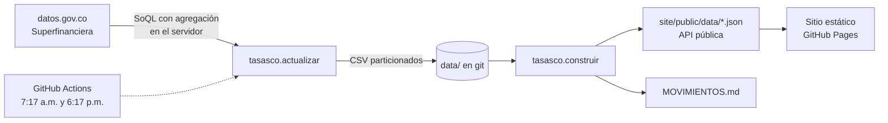

# Tasas CO

**¿Dónde rinde más un CDT? ¿Quién subió las tasas de crédito este mes? ¿Cuánto está el dólar frente a su rango del año?**

Tasas CO responde esas preguntas con los datos oficiales que los bancos reportan a la Superintendencia Financiera de Colombia. Se actualiza solo dos veces al día y publica todo como datos abiertos.

**Sitio:** https://juanjo32.github.io/tasas-co/ · **Resumen semanal:** [MOVIMIENTOS.md](MOVIMIENTOS.md)

| Qué | Detalle | Desde |
|---|---|---|
| CDT | Tasa efectiva anual de los CDT emitidos cada día, por entidad y plazo (30 a más de 360 días) | 2022 |
| Crédito | Tasa promedio de los créditos desembolsados cada semana, por entidad y producto (tarjeta, libre inversión, libranza, vehículo…) | jul-2022 |
| Usura | Interés bancario corriente certificado y tasa de usura (1,5×) | 2015 |
| TRM | Tasa representativa del mercado diaria | 1991 |

## Cómo funciona



1. **Extracción** ([`tasasco/fuentes.py`](tasasco/fuentes.py), [`tasasco/actualizar.py`](tasasco/actualizar.py)). La fuente de tasas de crédito trae unas **900.000 filas por semana**, desagregadas por sexo, municipio, CIIU, garantía, plazo y más. En vez de descargarlas, la consulta SoQL agrega en el servidor (`sum(tasa × monto) / sum(monto)` agrupado por semana, entidad y producto) y baja unas 1.000. El histórico completo cabe en pocos MB. El dataset histórico no está indexado por fecha: agregar una sola semana puede tardar más de 4 minutos. Por eso se rellena hacia atrás por partes, con un presupuesto de 25 minutos por corrida y guardando cada semana, mientras lo reciente sale en segundos del dataset de los últimos dos meses.
2. **Almacenamiento** ([`tasasco/almacen.py`](tasasco/almacen.py)). CSV particionados por mes (CDT) o por año (crédito), con orden estable. Cada actualización reemplaza por fecha lo que la fuente haya corregido, y el diff de cada commit muestra solo las filas nuevas. Es *git scraping*: el historial del repo es el historial de las tasas.
3. **Métricas** ([`tasasco/construir.py`](tasasco/construir.py)). Promedios ponderados por monto, ranking por plazo y producto, cambios a cuatro semanas y movimientos destacados.
4. **Sitio** ([`site/`](site)). TypeScript sin framework y gráficas SVG propias, con cruz y tooltip, navegación por teclado y modo oscuro. Pesa unos 10 KB comprimido.

### Decisiones de método

- **Ponderar por monto.** Un CDT de $10.000 millones pesa más que uno de $1 millón. El promedio simple exagera a las entidades pequeñas.
- **Umbral de volumen.** Para entrar a un ranking, la entidad debe tener al menos 0,3% del monto del plazo o producto. Así un CDT aislado con tasa atípica no aparece como "el mejor".
- **Ventana de 7 días en CDT.** La tasa diaria por entidad es ruidosa; una semana la suaviza sin esconder cambios reales.
- **Tasas observadas, no ofrecidas.** Son operaciones ya hechas (CDT emitidos y créditos desembolsados). Muestran lo que el mercado está pagando y cobrando, no la tasa que una entidad te va a ofrecer a ti.

## API pública

Archivos JSON estáticos, sin registro, actualizados con cada corrida:

| Archivo | Contenido |
|---|---|
| [`resumen.json`](https://juanjo32.github.io/tasas-co/data/resumen.json) | Rankings de CDT y crédito, usura vigente, TRM y movimientos |
| [`cdt_series.json`](https://juanjo32.github.io/tasas-co/data/cdt_series.json) | Promedio semanal por plazo, del sistema y de las 12 entidades más grandes |
| [`credito_series.json`](https://juanjo32.github.io/tasas-co/data/credito_series.json) | Promedio semanal del sistema por producto |
| [`trm.json`](https://juanjo32.github.io/tasas-co/data/trm.json) | TRM diaria desde 2015 |
| [`usura.json`](https://juanjo32.github.io/tasas-co/data/usura.json) | Tasa de usura de consumo |

Los datos crudos están en [`data/`](data) en CSV.

```bash
curl -s https://juanjo32.github.io/tasas-co/data/resumen.json | jq '.cdt.plazos[] | select(.plazo_dias==360) | .entidades[:3]'
```

## Correrlo localmente

```bash
pip install -e ".[dev]"
python -m pytest -q                 # pruebas sin red
python -m tasasco actualizar        # CDT y TRM completos; el crédito histórico se rellena 25 min por corrida
python -m tasasco construir         # genera site/public/data y MOVIMIENTOS.md

cd site && npm ci && npm run dev    # sitio en http://localhost:5173
```

Opcional: un [app token de datos.gov.co](https://www.datos.gov.co/profile/edit/developer_settings) en `SOCRATA_APP_TOKEN` sube los límites de la API.

## Fuentes

Todas publicadas por la Superintendencia Financiera de Colombia en datos.gov.co:
[captación y CDT (`axk9-g2nh`)](https://www.datos.gov.co/d/axk9-g2nh) ·
[tasas activas por tipo de crédito, histórico (`w9zh-vetq`)](https://www.datos.gov.co/d/w9zh-vetq) y [últimos dos meses (`qzsc-9esp`)](https://www.datos.gov.co/d/qzsc-9esp) ·
[interés bancario corriente (`pare-7x5i`)](https://www.datos.gov.co/d/pare-7x5i) ·
[TRM (`32sa-8pi3`)](https://www.datos.gov.co/d/32sa-8pi3).

## Licencia

Código bajo [MIT](LICENSE). Los datos son públicos y pertenecen a sus fuentes. Esto no es asesoría financiera.
